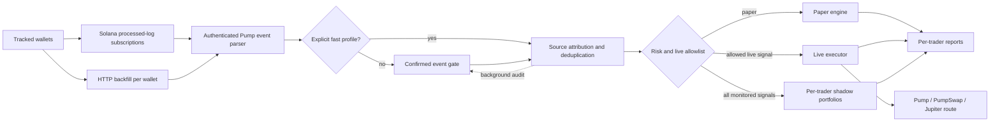

# Pump.fun Multi-Trader Copybot

[](https://github.com/murlockwarlock/pumpfun-multi-trader-copybot/actions/workflows/ci.yml)


[](LICENSE)

A low-latency Solana copy-trading engine that monitors multiple public wallets,
decodes authenticated Pump.fun activity, and mirrors eligible trades in paper or
guarded live mode.

The project focuses on execution safety and operational reliability: per-trader
position ownership, durable ingestion cursors, HTTP gap recovery, global risk
limits, crash recovery, and auditable JSONL logs.

> [!WARNING]
> This is experimental software, not financial advice. Copy trading cannot
> reproduce the source wallet's position in the same slot or guarantee the same
> price. Memecoins can become illiquid or lose all value.

## Highlights

- Monitor up to 50 named Solana wallets from one process.
- Redundant, staggered `processed` WebSocket subscriptions and durable backfill
  cursors.
- Decode official Pump bonding-curve and PumpSwap events with program-stack
  provenance checks; normal profiles re-check before submission, while an
  explicit launch-sniper profile submits first and audits confirmation after.
- Require the tracked wallet to be an authenticated signer.
- Collapse supported multi-hop routes to the final traded token.
- Keep positions isolated by source trader; one trader's SELL cannot close
  another trader's position.
- Separate the monitoring list from the live execution allowlist.
- Enforce global position, daily spend, reserve, realized-loss, signal-age, and
  price-drift limits, including target-relative min-out protection on-chain.
- Run a fee-aware shadow portfolio for every monitored trader alongside guarded
  live execution, Telegram reports, and exact realized PnL accounting.
- Recover incomplete settlements and retry emergency exits after restarts.
- Make a submitted BUY sellable only when a measured pre-BUY baseline and
  sufficient post-BUY inventory are proven; a positive transaction delta alone
  never proves the currently available strategy inventory.
- Deploy atomically with systemd health checks and automatic rollback.

## Architecture



The normal WebSocket path decodes a processed event immediately, then re-decodes
the same authenticated event from the confirmed transaction before submission.
An explicitly allowlisted fast profile can prepare from the processed event and
verify it afterward; live submission additionally requires the executor to
provide inventory provenance. A mismatch automatically pauses new live buys.
Periodic HTTP backfill repairs gaps caused by disconnects or restarts.

## Quick start

Requirements: Node.js 24+ and an HTTPS/WSS Solana RPC endpoint.

```bash
git clone https://github.com/murlockwarlock/pumpfun-multi-trader-copybot.git
cd pumpfun-multi-trader-copybot
cp .env.example .env
npm ci --ignore-scripts
npm test
npm start
```

Before starting, replace the placeholder wallets in `.env`:

```dotenv
TRADING_MODE=paper
TARGET_WALLETS=alpha:SOLANA_WALLET_1,beta:SOLANA_WALLET_2
LIVE_TRADER_WALLETS=none
RPC_HTTP_URL=https://your-solana-rpc.example
RPC_WS_URL=wss://your-solana-rpc.example
RPC_FALLBACK_HTTP_URL=https://your-independent-fallback.example
RPC_FALLBACK_WS_URL=wss://your-independent-fallback.example
RPC_FALLBACK_WS_STAGGER_MS=30000
```

`TARGET_WALLET` is retained as a backwards-compatible single-wallet fallback.

## Multi-trader safety model

`TARGET_WALLETS` controls observation. `LIVE_TRADER_WALLETS` controls who may
open real positions.

```dotenv
TARGET_WALLETS=alpha:WALLET_A,beta:WALLET_B,gamma:WALLET_C
LIVE_TRADER_WALLETS=alpha
```

In this example, all three traders are monitored, but only `alpha` can trigger
live orders. Signals from `beta` and `gamma` are recorded as
`trader_monitor_only`, while their independent shadow portfolios continue to
trade and appear in ranked reports.

The live allowlist can contain configured names or exact wallet addresses. If a
trader is removed from the allowlist, new BUY orders stop immediately, while an
already-owned position can still be sold safely.

### Shadow-paper ranking

`SHADOW_ENABLED=true` is the default in live mode. Every monitored trader gets
a durable simulated portfolio with its own position and daily loss limits. The
simulation charges Pump fees, a latency/slippage penalty, and a fixed estimated
transaction cost on entry and exit.

```dotenv
SHADOW_TRADE_SOL=0.005
SHADOW_MAX_OPEN_POSITIONS_PER_TRADER=5
SHADOW_LATENCY_PENALTY_BPS=300
SHADOW_TX_FEE_SOL=0.00011
```

Keep new candidates monitor-only until enough shadow positions have closed to
compare their net results after estimated costs.

### Launch-sniper fast profile

Fast mode is opt-in per monitored trader and is intended for wallets whose
positions last only a few seconds:

```dotenv
FAST_TRADER_WALLETS=sniper_name
FAST_INVENTORY_POLICY=isolated_wallet
FAST_ISOLATION_WALLET_ADDRESS=<dedicated-wallet-address>
FAST_ISOLATION_CONFIRMATION=I_UNDERSTAND_FAST_ISOLATED_WALLET
FAST_MAX_SIGNAL_AGE_MS=1500
FAST_MAX_ENTRY_DRIFT_BPS=2500
FAST_SKIP_SIMULATION=true
FAST_SHADOW_PROBE_ENABLED=true
```

The parser accepts event bytes only while the official Pump program is at the
top of the Solana program log stack. In monitor-only mode the bot builds, signs,
but does not submit a real candidate transaction; that read-only probe records
the actual log-to-ready latency and available token quote. In live mode the same
path submits through the configured sender only when a pre-BUY inventory proof is
available. The execution executor captures processed, confirmed, and finalized
context slots in parallel with quote and transaction preparation, takes the
conservative maximum balance, and requires rooted evidence. This adds no
serialized confirmation wait. Skipping simulation reduces latency but increases the probability
that a transaction fails on-chain, so keep the fast wallet list explicit and
small. FAST BUY additionally requires the dedicated-wallet policy above. A
shared wallet, an unverified delegate, or a wallet with an untracked external
outflow is not eligible for FAST BUY; the engine blocks before signing or
broadcasting. The confirmation string is an operator attestation, not a claim
that ordinary balance snapshots can reconstruct arbitrary token flows. The
standard `PumpExecutor` deliberately does not manufacture this proof; an
audited adapter must attach `dedicated_wallet_flow_ledger` with a durable flow
cursor, `flowCoverage.gapFree=true`, and `noExternalOutgoing=true`. Before every
FAST SELL the engine calls that adapter again, requires coverage to start at the
persisted cursor, a non-decreasing cursor sequence and a newer checked slot,
then requires that watermark to reach the context slot of the token balance
used to authorize the SELL, and persists the refreshed proof before building
the SELL. Crash recovery restores the FAST policy and proof from the durable
BUY signal; missing legacy provenance is quarantined. A delegate seen in any
baseline or refresh observation invalidates the proof and quarantines the
position.

For fast profiles, the configured entry-drift ceiling is also converted into a
minimum token output inside the signed transaction. A quote that passes locally
cannot then consume the separate slippage allowance and land beyond that target-
relative ceiling. A matching SELL can be built at `processed` only when the
executor has a trusted, signature-specific processed token-delta source *and a
measured pre-BUY baseline*. A balance increase or a positive transaction delta
by itself is never treated as proof of currently sellable inventory. When the
baseline or its rooted/context evidence is unknown, FAST BUY is rejected before
broadcast. An audited isolated-inventory executor may provide an explicit
`inventoryIsolationProof.verified=true` proof without adding a confirmation wait.

Confirmed BUY recovery records the pre-BUY inventory floor. If current
inventory is below that floor plus the transaction-specific BUY delta, the
mint is quarantined as ownership-ambiguous and remains non-sellable across
restart, even if a later foreign transfer restores the numeric balance.
Confirmed SELL settlement uses its own transaction token delta as the source of
sold quantity; missing metadata or a delta larger than the proven position is
surfaced as unknown instead of using an arbitrary balance snapshot or
rebroadcasting blindly.

### Inventory ownership model

The durable state for one mint distinguishes these facts instead of treating a
single balance snapshot as a complete ledger:

| State | Meaning |
|---|---|
| `beforeTokenBalance` + `beforeTokenBalanceKnown` | Conservative pre-BUY baseline from multi-commitment reads; FAST requires an explicit known flag |
| `beforeTokenBalanceEvidence` | Context slots from processed/confirmed/finalized reads, including rooted evidence |
| `inventoryIsolationProof` | Required dedicated-wallet flow-ledger proof; balance snapshots alone never substitute for it |
| Transaction-specific BUY delta | Proof that this signed BUY acquired tokens; it is not proof of current availability |
| Position `rawTokenAmount` | Remaining strategy amount after confirmed, transaction-specific SELL deltas |
| `inventoryBaselineRaw` | The baseline floor that must remain below the strategy amount before SELL is allowed |
| `quarantines[mint]` | Sticky evidence that baseline/history/flow is incomplete or inconsistent; keyed by mint and durable beyond signal pruning |
| Pending/ambiguous signals | Reserved exposure whose outcome is not yet known; ambiguous submits are never blindly retried |

The strategy sellable amount is non-zero only when the baseline is known, the
current balance is at least `baseline + position amount`, and no mint-scoped
quarantine exists. External deficits, unexplained zero balances, unavailable
metadata, and SELL deltas exceeding the proven amount preserve the position and
enter quarantine rather than creating a fake SELL or PnL result. Standard Solana
RPC does not guarantee a complete historical sequence of every fungible-token
movement between two observations; when that sequence cannot be proven, the
implementation fails closed and requires an explicit audited resolution.

A quarantined BUY that is later proven failed on-chain is a separate terminal
case: after verified fee evidence and zero owned inventory are persisted, an
operator may call `releaseFailedBuyQuarantine` with the matching transaction
signature, fee, and non-empty audit evidence. This removes only that failed-BUY
quarantine and permits a new BUY; ambiguous or successful BUY quarantines still
require a restored position through `clearQuarantine`.

A fully proven SELL that consumes the last strategy tokens is also resolved by
an explicit `releaseClosedSellQuarantine` procedure. It requires the completed
transaction-specific SELL settlement, zero remaining position, no unresolved
mint transactions, and audit evidence; partial or ambiguous SELLs remain
quarantined.

## Live mode

Live execution is fail-closed. It requires all of the following:

1. `TRADING_MODE=live`
2. `LIVE_CONFIRMATION=I_UNDERSTAND_REAL_FUNDS`
3. A regular `0600` Solana JSON keypair file
4. `LIVE_WALLET_ADDRESS` matching the keypair
5. At least one explicit entry in `LIVE_TRADER_WALLETS`

Recommended first run:

```dotenv
LIVE_TRADE_SOL=0.005
LIVE_MAX_DAILY_SPEND_SOL=0.03
LIVE_MIN_RESERVE_SOL=0.02
MAX_OPEN_POSITIONS=1
LIVE_SIMULATE=true
```

Supported send routes are `rpc`, `jito`, `helius-swqos`, and `helius-max`.
SOL-quoted Pump trades use the direct venue path. Token-quoted PumpSwap trades
use a Jupiter atomic route from SOL to the copied mint (and back to SOL on
exit), so the wallet does not need to pre-hold USDC, USDT, or another quote
token. API keys and the signing keypair must remain in permission-restricted
files, never in `.env` or source control.

To stop new live BUY orders without disabling monitoring or emergency exits,
create the configured kill-switch file:

```bash
touch data/STOP_LIVE
```

## Reliability and risk controls

| Control | Purpose |
|---|---|
| Signer verification | Reject transfers and spam that merely mention a target wallet |
| Confirmed event gate | Normal profiles block until processed and confirmed events match |
| Fast-profile audit | Explicit profiles use program-provenance-checked logs, then auto-pause on mismatch |
| Token-quoted routing | Copy non-SOL PumpSwap pairs through Jupiter without pre-funding quote tokens |
| Signature quarantine | Retry a broken transaction, then isolate only that signature so its cursor advances |
| Per-target health | A stale monitored wallet cannot restart or stop healthy live traders |
| Per-trader ownership | Prevent cross-trader SELL signals from closing the wrong position |
| Shadow portfolios | Compare monitored traders using isolated, fee-aware simulations |
| Signal-age limit | Avoid copying stale transactions after reconnects |
| Entry-drift min-out | Reject a bad quote and enforce the target-relative ceiling inside the transaction |
| Processed BUY readiness | Permit an immediate SELL while final BUY accounting continues in background |
| Token provenance quarantine | Block sales when external transfers make remaining inventory ambiguous |
| Transaction-specific settlement | Attribute BUY/SELL quantities to their signed transaction, not a raw balance change |
| Dual WSS and execution RPC | Deduplicate two staggered feeds and retry transport/rate-limit failures through the fallback |
| Daily spend/loss caps | Bound aggregate exposure across every followed trader |
| SOL reserve | Keep enough balance for exits and transaction fees |
| Durable cursors | Resume each tracked wallet without silently losing gaps |
| Exit retries | Continue SELL attempts after route or confirmation failures |
| Exact raw amounts | Avoid floating-point loss in live token balances |
| Atomic deployment | Roll back automatically if subscriptions or backfill fail |

## Reports and audit trail

Every decision is written as JSONL with the source name and source wallet.
Telegram reports summarize detected signals per trader, confirmed BUY and SELL
counts, skipped signals, exact live PnL, ranked shadow PnL, open positions, and
risk pauses.

Routine WebSocket reconnects are kept out of Telegram to avoid notification
noise. Actionable failures, blocked exits, risk pauses, settlements, and admin
reports are still delivered.

## Testing

```bash
npm test
```

The test suite covers event parsing, confirmed fast-signal verification, signer
checks, multi-hop normalization, independent shadow portfolios, multi-trader
position isolation, processed-before-confirmed exits, durable state, live
settlement, on-chain price drift, max-hold exits, token-account cleanup, RPC
failover, and reporting.

## Deployment

The included PowerShell and Bash deployment scripts create immutable releases,
install production dependencies, switch a symlink atomically, restart systemd,
verify WebSocket and HTTP ingestion, and roll back on failure.

Local deployment credentials and server pointers are intentionally ignored by
Git. See `deploy/deploy.ps1` and `deploy/remote_deploy.sh` for the workflow.

## Project layout

```text
src/
  index.js               ingestion and multi-wallet orchestration
  parser.js              Pump / PumpSwap event and transaction parsing
  paper-engine.js        source-isolated paper execution
  live-engine.js         guarded live execution and settlement recovery
  pump-executor.js       transaction preparation and route selection
  live-state.js          durable positions, signals, and risk counters
  live-report.js         aggregate and per-trader reporting
  shadow-engine.js       isolated fee-aware simulation for every trader
  fast-verifier.js       processed-vs-confirmed trade-set comparison
deploy/                   atomic server deployment and operational scripts
test/                     Node.js test suite
```

## Security

Never commit RPC keys, Telegram tokens, Jupiter keys, server credentials, seed
phrases, private keys, or live state. The repository ignores `.env`, `secrets/`,
`data/`, `work/`, and local deployment configuration. See [SECURITY.md](SECURITY.md)
for reporting and key-handling guidance.

## License

[MIT](LICENSE)
