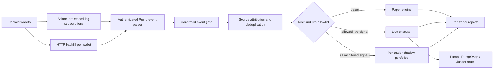

# Pump.fun Multi-Trader Copybot

[](https://github.com/murlockwarlock/pumpfun-multi-trader-copybot/actions/workflows/ci.yml)


[](LICENSE)

A low-latency Solana copy-trading engine that monitors multiple public wallets,
decodes authenticated Pump.fun activity, and mirrors eligible trades in paper or
guarded live mode.

The project focuses on execution safety and operational reliability: per-trader
position ownership, durable ingestion cursors, HTTP gap recovery, global risk
limits, crash recovery, and auditable JSONL logs.

> [!WARNING]
> This is experimental software, not financial advice. Copy trading cannot
> reproduce the source wallet's position in the same slot or guarantee the same
> price. Memecoins can become illiquid or lose all value.

## Highlights

- Monitor up to 50 named Solana wallets from one process.
- Independent `processed` WebSocket subscriptions and durable backfill cursors.
- Decode official Pump bonding-curve and PumpSwap events, then re-check the
  authenticated event in the confirmed transaction before live submission.
- Require the tracked wallet to be an authenticated signer.
- Collapse supported multi-hop routes to the final traded token.
- Keep positions isolated by source trader; one trader's SELL cannot close
  another trader's position.
- Separate the monitoring list from the live execution allowlist.
- Enforce global position, daily spend, reserve, realized-loss, signal-age, and
  price-drift limits.
- Run a fee-aware shadow portfolio for every monitored trader alongside guarded
  live execution, Telegram reports, and exact realized PnL accounting.
- Recover incomplete settlements and retry emergency exits after restarts.
- Deploy atomically with systemd health checks and automatic rollback.

## Architecture



The WebSocket path decodes a processed event immediately, then re-decodes the
same authenticated event from the confirmed transaction. A live order is
blocked unless both trade sets match exactly. Periodic HTTP backfill repairs
gaps caused by disconnects or restarts.

## Quick start

Requirements: Node.js 24+ and an HTTPS/WSS Solana RPC endpoint.

```bash
git clone https://github.com/murlockwarlock/pumpfun-multi-trader-copybot.git
cd pumpfun-multi-trader-copybot
cp .env.example .env
npm ci --ignore-scripts
npm test
npm start
```

Before starting, replace the placeholder wallets in `.env`:

```dotenv
TRADING_MODE=paper
TARGET_WALLETS=alpha:SOLANA_WALLET_1,beta:SOLANA_WALLET_2
LIVE_TRADER_WALLETS=none
RPC_HTTP_URL=https://your-solana-rpc.example
RPC_WS_URL=wss://your-solana-rpc.example
```

`TARGET_WALLET` is retained as a backwards-compatible single-wallet fallback.

## Multi-trader safety model

`TARGET_WALLETS` controls observation. `LIVE_TRADER_WALLETS` controls who may
open real positions.

```dotenv
TARGET_WALLETS=alpha:WALLET_A,beta:WALLET_B,gamma:WALLET_C
LIVE_TRADER_WALLETS=alpha
```

In this example, all three traders are monitored, but only `alpha` can trigger
live orders. Signals from `beta` and `gamma` are recorded as
`trader_monitor_only`, while their independent shadow portfolios continue to
trade and appear in ranked reports.

The live allowlist can contain configured names or exact wallet addresses. If a
trader is removed from the allowlist, new BUY orders stop immediately, while an
already-owned position can still be sold safely.

### Shadow-paper ranking

`SHADOW_ENABLED=true` is the default in live mode. Every monitored trader gets
a durable simulated portfolio with its own position and daily loss limits. The
simulation charges Pump fees, a latency/slippage penalty, and a fixed estimated
transaction cost on entry and exit.

```dotenv
SHADOW_TRADE_SOL=0.005
SHADOW_MAX_OPEN_POSITIONS_PER_TRADER=5
SHADOW_LATENCY_PENALTY_BPS=300
SHADOW_TX_FEE_SOL=0.00011
```

Keep new candidates monitor-only until enough shadow positions have closed to
compare their net results after estimated costs.

## Live mode

Live execution is fail-closed. It requires all of the following:

1. `TRADING_MODE=live`
2. `LIVE_CONFIRMATION=I_UNDERSTAND_REAL_FUNDS`
3. A regular `0600` Solana JSON keypair file
4. `LIVE_WALLET_ADDRESS` matching the keypair
5. At least one explicit entry in `LIVE_TRADER_WALLETS`

Recommended first run:

```dotenv
LIVE_TRADE_SOL=0.005
LIVE_MAX_DAILY_SPEND_SOL=0.03
LIVE_MIN_RESERVE_SOL=0.02
MAX_OPEN_POSITIONS=1
LIVE_SIMULATE=true
```

Supported send routes are `rpc`, `jito`, `helius-swqos`, and `helius-max`.
Composite routes use Jupiter. API keys and the signing keypair must remain in
permission-restricted files, never in `.env` or source control.

To stop new live BUY orders without disabling monitoring or emergency exits,
create the configured kill-switch file:

```bash
touch data/STOP_LIVE
```

## Reliability and risk controls

| Control | Purpose |
|---|---|
| Signer verification | Reject transfers and spam that merely mention a target wallet |
| Confirmed event gate | Block live execution unless processed and confirmed events match |
| Per-trader ownership | Prevent cross-trader SELL signals from closing the wrong position |
| Shadow portfolios | Compare monitored traders using isolated, fee-aware simulations |
| Signal-age limit | Avoid copying stale transactions after reconnects |
| Entry-drift limit | Reject a BUY when the available price moved too far |
| Daily spend/loss caps | Bound aggregate exposure across every followed trader |
| SOL reserve | Keep enough balance for exits and transaction fees |
| Durable cursors | Resume each tracked wallet without silently losing gaps |
| Exit retries | Continue SELL attempts after route or confirmation failures |
| Exact raw amounts | Avoid floating-point loss in live token balances |
| Atomic deployment | Roll back automatically if subscriptions or backfill fail |

## Reports and audit trail

Every decision is written as JSONL with the source name and source wallet.
Telegram reports summarize detected signals per trader, confirmed BUY and SELL
counts, skipped signals, exact live PnL, ranked shadow PnL, open positions, and
risk pauses.

Routine WebSocket reconnects are kept out of Telegram to avoid notification
noise. Actionable failures, blocked exits, risk pauses, settlements, and admin
reports are still delivered.

## Testing

```bash
npm test
```

The test suite covers event parsing, confirmed fast-signal verification, signer
checks, multi-hop normalization, independent shadow portfolios, multi-trader
position isolation, durable state, live settlement, price drift, max-hold exits,
token-account cleanup, RPC failover, and reporting.

## Deployment

The included PowerShell and Bash deployment scripts create immutable releases,
install production dependencies, switch a symlink atomically, restart systemd,
verify WebSocket and HTTP ingestion, and roll back on failure.

Local deployment credentials and server pointers are intentionally ignored by
Git. See `deploy/deploy.ps1` and `deploy/remote_deploy.sh` for the workflow.

## Project layout

```text
src/
  index.js               ingestion and multi-wallet orchestration
  parser.js              Pump / PumpSwap event and transaction parsing
  paper-engine.js        source-isolated paper execution
  live-engine.js         guarded live execution and settlement recovery
  pump-executor.js       transaction preparation and route selection
  live-state.js          durable positions, signals, and risk counters
  live-report.js         aggregate and per-trader reporting
  shadow-engine.js       isolated fee-aware simulation for every trader
  fast-verifier.js       processed-vs-confirmed trade-set comparison
deploy/                   atomic server deployment and operational scripts
test/                     Node.js test suite
```

## Security

Never commit RPC keys, Telegram tokens, Jupiter keys, server credentials, seed
phrases, private keys, or live state. The repository ignores `.env`, `secrets/`,
`data/`, `work/`, and local deployment configuration. See [SECURITY.md](SECURITY.md)
for reporting and key-handling guidance.

## License

[MIT](LICENSE)
